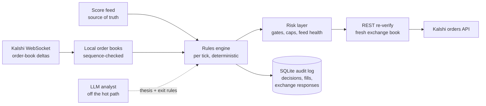

# Fairline Trading

[](https://github.com/adityaseelaboyina/fairline-trading/actions/workflows/tests.yml)


**A live, event-driven trading system for in-play soccer markets on Kalshi, with a
fail-closed risk layer between every decision and the exchange.**

It streams the order book over WebSocket, tracks the real score from an independent
feed, and trades the gap between *what just happened on the field* and *what the
price says yet*.

Ran live through the 2026 World Cup: **90+ live orders across 50+ in-play markets,
100K+ order-book updates processed, net profitable.** Results, including what didn't
work, are in [docs/RESULTS.md](docs/RESULTS.md).

## Architecture



- **Feed → risk layer → execution → logging.** Nothing reaches the exchange without
  passing every gate, and every decision, fill and exchange response is logged.
- **The score is truth, the price is not.** Positions exit when the verified score
  changes the outcome, never on price wobbles. No price-based stop-losses.
- **The LLM is never in the fast path.** It writes a thesis and machine-readable exit
  rules ahead of time; the engine executes them deterministically on every tick.
- **Orders are priced off the exchange's own book.** Right before sending, the system
  fetches a fresh REST snapshot instead of trusting its local WebSocket copy.

## Risk layer

Live mode refuses to start unless every gate is configured. All of these are covered
by the risk-layer test suite (`tests/test_gates.py`).

**Price and size**
- Entry price band: no entries below 15¢ (cheap longshots) or above 90¢ (fees dominate)
- Position sized as a fixed fraction of the *live* account balance, with a hard cap
  per order and a maximum contract count
- Rejects implausibly large "edges", which almost always mean bad data

**Exposure**
- Per-game concentration cap, computed from freshly fetched exchange positions;
  fails closed if that fetch fails
- At most 2 directional positions per game, to prevent stacking correlated bets
- Daily loss stop, plus a file-based kill switch (`touch run/STOP`)
- No new entries late in the game

**Feed health**
- Stale score feed blocks orders for that game
- WebSocket sequence gaps mark every book dirty until it is re-snapshotted; dirty
  books can't be traded
- Score/price contradiction breaker catches a feed that froze on a wrong score
- Video-review (VAR) reversals: the reversed goal is flagged, the game is
  blacklisted briefly, and affected positions are flattened

## Audit: 9 bugs found and fixed

Auditing the execution logs against the exchange's own records turned up these.
Each fix has a regression test.

| What went wrong | Effect | Fix |
|---|---|---|
| A position sold early was also credited its settlement payout | Exits counted twice, inflating P&L | Ledger rebuilds each position from exchange fills: sold quantity vs. quantity held to settlement |
| Duplicate settlement rows after reconnects and restarts | Settlement results double- and triple-counted | Deduplicate to one row per market |
| Simulated fills priced at the mid | Strategy P&L overstated | Price at the worst order-book level needed to fill the full order |
| Local book drifted from the exchange **without** a sequence gap | Orders chased prices that weren't there (local 13–42¢ vs. exchange 99¢) | Re-fetch the exchange's book over REST before every order; buys fail closed |
| Books kept trading while recovering from a sequence gap | Decisions made on stale state | Dirty flag; refuse to trade until re-snapshotted |
| Exchange moved old records to an archive endpoint | Missing history was booked as losses | Query the archive; never treat "no data" as a loss |
| Kalshi orders are YES-side only; NO trades must be inverted | NO-side orders would have been sent wrong | Explicit YES/NO translation layer with tests |
| Exposure cap read in-memory positions that went stale | An oversized order got past the cap | Fetch live positions before every buy; fail closed |
| Restarting mid-game forgot open positions | Live positions left unmanaged | Startup reconciliation from exchange positions |

## How new strategies get validated

Nothing trades real money first. Each strategy ("lane") runs in **shadow**: logged as
if traded, priced at the depth it would actually fill at. Arming thresholds are
written down *before* results come in, and each lane is scored separately. Four ideas
were rejected this way without risking money. One passed in shadow but filled 0 of 14
live orders; the audit traced it to the stale-book bug above.

## Layout

| Path | What it does |
|---|---|
| `main.py` | Entry point and orchestration: lanes, gates, live order path, goal and VAR handling |
| `data/kalshi_auth.py` | RSA-PSS request signing |
| `data/kalshi_ws.py` | Authenticated WebSocket, sequence-gap detection and recovery |
| `data/kalshi_rest.py` | REST client, including the exchange's historical archive |
| `data/orderbook.py` | Local book from snapshots and deltas; depth-walking fill prices |
| `data/score_feed.py` | Live scores; detects goals and score corrections |
| `data/discover.py` | Finds the day's markets and maps them to score-feed games |
| `engine/rules.py` | Deterministic per-tick rules engine and exit logic |
| `engine/markets.py` | Ticker parsing for any soccer league; score-based exits |
| `engine/live_broker.py` | Order placement: YES/NO translation, sizing |
| `engine/sniper.py` | Post-goal strategies and a goal-burst detector |
| `engine/analyst.py` | LLM analyst with a strict JSON contract |
| `engine/longshot.py` | Separate shadow-only strategy for daily weather markets |
| `tradelog/recorder.py` | SQLite audit log: decisions, fills, shadow trades, order responses |
| `ledger.py` | P&L by position and by strategy, reconciled against the exchange |
| `overshoot_report.py` | How prices behave after goals; shadow-strategy scorecards |
| `tests/` | 75 tests in 8 suites, including 17 for the risk gates and 6 audit regressions |

## Run it

```bash
python -m venv .venv && source .venv/bin/activate   # Python 3.9+
pip install -r requirements.txt
cp .env.example .env               # fill in your Kalshi and Anthropic credentials
cp config.example.yaml config.yaml  # starts in paper mode, unarmed
```

Set `market_tickers` and `score_feed.event_map` in `config.yaml` for the day's games
(`python main.py --discover <GAME_CODE>` lists a game's markets).

```bash
# Preview: real prices and real-balance sizing, prints each order, sends nothing.
# Requires paper_mode: true in config.yaml.
python main.py --config config.yaml --dry-run

# Real money. Requires paper_mode: false AND live.armed: true AND the --arm flag.
python main.py --config config.yaml --live --arm

python ledger.py --live    # reconciled P&L
```

## Tests

No network or credentials needed. They run on every push on Python 3.9 and 3.14.

```bash
for t in core gates sniper research integrity clubsoccer longshot audit; do
  python tests/test_$t.py
done
```

## Disclaimer

Educational project. Not financial advice. It can place real orders with real money;
use at your own risk.
